# 简答题题库（共 11 题）
> 由 `简答题.txt` 整理，原题库示意图已下载至 `images/essay/` 并在下方内嵌显示。

---

## 第 1 题 · 四、教学大纲（1.0分）

### 题目

四、教学大纲

公司计划针对新员工开展机器学习特征工程相关的专项培训。以下列举了与算法工程师职能相关的部分基础技能与知识点：

①特征构造与衍生方法

②特征选择技术（过滤法、嵌入法）

③分箱与编码技术

请选取与当前培训内容相关的选项，完成编写本次培训的大纲。

### 参考答案

机器学习特征工程实战培训大纲

一、培训课时

16课时

二、培训内容

1 特征工程的目标、意义与基本流程

2 特征构造：领域知识驱动与自动特征生成

3 特征选择：过滤式、包裹式与嵌入式方法详解

4 类别特征与连续特征处理：分箱、独热编码与目标编码

5 特征工程全流程综合案例实战

---

## 第 2 题 · 一、智能系统分析（1.0分）

### 题目

一、智能系统分析

当前，长视频行业竞争日趋白热化，用户内容消费呈现多元化、圈层化趋势。随着自制内容投入加大和版权采买成本攀升，平台亟需通过精准推荐提升内容分发效率，降低用户决策成本。然而，海量用户行为数据噪声显著，内容体系混乱，严重制约算法效果。同时，老片长尾挖掘等问题日益突出，传统推荐策略难以兼顾用户体验与商业目标，构建更智能、更稳健的推荐体系成为行业关键突破口。

问题一：针对系统初始化阶段的数据稀疏性问题（如新用户推荐、新剧集上线初期），请提出具有可操作性的应对方法并简要说明其实现思路。

问题二：在系统建模前，针对于长视频相关数据往往会进行数据清洗、数据标准化与交叉验证关键操作，请对其步骤进行详细解释说明。

问题三：请从内容（如热门内容的曝光均衡）、系统（如点击率率）、用户（如互动率）等多个维度，综合评估当前视频个性化匹配流程的效能。

问题四：针对于长视频推荐系统，请提出具备可操作性的优化策略。

### 参考答案

第一问：

知识图谱辅助：基于影视实体（演员/题材/导演）关联用户历史偏好，实现语义级推荐。

跨域信息迁移：利用社交媒体兴趣或设备聚类生成初始画像；设计“快速兴趣标记”流程（如标签选择、影片打分），30秒内收集偏好信号。

热度排行：依据当前播放量或同时播放人数进行视频排行，较为火热的电视进行推荐。

用户注册信息收集：用户注册平台账号，设置基础信息填写（例如：喜欢的演员等），以此基于关联信息进行分析推荐。

第二问：

行为数据审核：清洗异常播放、剔除机器人行为（空记录等）、校正观看深度权重。

数据标准化：构建多级标签体系，完成数据标注，结合NLP提取+人工审核+多源（豆瓣/弹幕）交叉验证，验证数据完整等信息。

质量监控闭环：实时监测标签覆盖率与异常比例，通过A/B测试迭代规则，查看数据质量，审查数据。

数据保护：安全存储，保护隐私，防止泄露；；持续调整、优化更新系统。

第三问：

覆盖率评估：衡量不同题材、热度内容的曝光分布均衡性；

命中率评估：通过用户对于推荐视频的点击率判断，是否准确，最后进行正确率评估。

满意度评估：通过完播率、评分反馈（播放后用户对推荐内容的评分）衡量用户体验。

第四问：

1 根据观看时段、设备类型适配推荐内容（如通勤时段推短剧）；引入序列建模（如Transformer）捕捉用户连续观看意图，优化连播推荐。

2 设计显式反馈轻量交互（如“不感兴趣”理由选择）；利用隐式反馈（播放速度、回放片段）动态调整用户兴趣向量。

3 增强数据预处理，剔除异常数据。

4 扩充数据集，增加用户信息特征，增加样本数据，以保证推荐准确性。

5 模型优化，采用深度学习模型，或修改模型参数，以达到更好模型效果。

---

## 第 3 题 · 一、智能系统分析（1.0分）

### 题目

一、智能系统分析
当前，线上医药电商行业正处于数字化深化转型的关键时期，用户线上购药需求持续增长带来订单处理压力激增，而传统模式下用药安全审核依赖人工导致效率瓶颈突出，用户健康档案、历史用药记录与实时交易数据分散于不同系统形成信息孤岛。与此同时，用户对购药流程的便捷性、药品配送的时效性以及个性化用药指导的专业性提出了更高要求，原有线下审核与分散式服务模式已难以支撑规模化、智能化的医药电商运营。在此背景下，构建智能化的医药电商服务平台、打通全链路数据流转体系、优化安全审核与数据协同机制，已成为提升医药服务效能与用药安全保障能力的关键突破口。
问题一：请针对该医药电商平台的非处方药（OTC）销售流程进行系统性分析，重点剖析从用户下单、订单传递、药师进行药品配置与分拣到药品配送完成的四个核心环节。要求明确每个环节的核心操作内容与系统交互逻辑。
问题二：该医药电商平台智能服务系统中，从用户提交购药订单到订单数据完成归档的完整样本获取流程尤为重要，请设计完整示意图。
问题三：现针对于设计的示意图，专家提出如下多方面的建议，请针对实际业务列举具体措施。
a．系统功能建设：如何优化从用户下单到药品交付全流程的数据录入方式与业务流转机制？
b.数据采集与处理：如何确保各环节采集数据的准确性、完整性，并实现多系统间数据格式统一与实时同步？
c.数据应用：如何利用沉淀的业务数据支持运营决策（如库存预警、用户复购分析、用药安全监测）？
d.保障措施：如何确保上述改进措施能够有效落地并形成持续优化的运行机制？

### 参考答案

问题一
a. 用户提交购药订单
用户通过医药电商APP或小程序选择药品，填写配送地址、联系方式和用药人信息，完成在线支付。
交互逻辑：用户提交的购药信息生成结构化订单数据包，实时推送至医药电商平台的订单管理系统。
b. 订单审核与智能分配
系统自动验证用户身份信息完整性、支付状态及历史购药记录安全合规性。平台根据预设规则（如药品库存状态、配送时效要求、用户收货地址区域）将订单自动分配至相应仓库或合作药店下对应的药师。
交互逻辑：通过审核的订单数据包（含分配结果）同步推送至对应仓库或药店的本地订单处理系统。
c. 药品分拣与打包
药师或配药员通过工作站接收订单任务，根据订单明细进行药品拣选、用药适宜性复核，完成药品核对后打包封箱，同步生成物流运单。
交互逻辑：拣货过程通过扫描系统记录药品批次信息，打包完成后订单状态更新为“待发货”，物流单号同步至订单主系统和物流平台。
d. 配送与订单闭环
物流服务商上门取件完成配送，用户签收药品后在平台确认收货。
交互逻辑：物流轨迹实时同步至订单跟踪系统，签收确认触发订单状态最终变更为“已完成”，全流程数据加密存储至历史数据库，完成服务闭环。
问题二

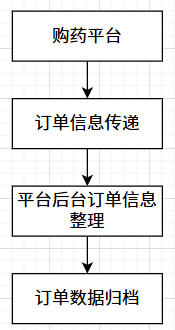

问题三
a. 系统功能建设
建设一体化药品销售平台：开发集药品浏览、在线咨询、处方上传、用药历史查询于一体的APP/小程序，实现用户从搜索到支付全流程在线化，从源头统一数据入口。
构建智能订单处理系统：基于药品类型、库存状态、配送地址等规则，自动分配订单至最优履约节点（仓库/药店），并生成结构化电子订单流。
目的：标准化前端交互流程，减少人工介入与信息传递误差。
b. 数据采集与处理
为药师及仓储人员配备移动作业终端：支持通过平板或PDA实时扫描药品条码、记录分拣进度、上传复核结果，确保操作数据即时同步。
建立中央数据交换平台：整合订单系统、仓储系统、物流系统及用户档案数据，统一数据格式与接口标准，实现多源数据实时清洗与融合。
目的：保障各环节数据采集的时效性与一致性，打破系统孤岛。
c. 数据应用与决策
开展用户用药行为与复购分析：基于历史订单与浏览数据，识别高潜复购人群、关联用药组合，支持个性化推荐与用药提醒。
搭建运营监控与预警看板：实时展示订单处理时效、库存周转率、配送异常率等核心指标，辅助进行库存预警、运力调度与客服资源分配。ss
目的：将数据转化为运营洞察，实现从被动接单到主动服务的模式升级。
d. 组织保障措施
组织分角色系统培训：针对药师、客服、运营人员分别开展订单处理、数据查询、报表解读等实操培训。
设立平台运维与用户反馈闭环机制：配置专职运维团队处理系统问题，定期调研用户与内部员工使用体验，迭代优化功能。
实施数据质量积分管理：将订单信息准确率、审核通过率、数据上报及时性等纳入各岗位绩效考核。
目的：确保系统用得起、用得顺、持续用，培育全员数据责任意识与协同文化。

---

## 第 4 题 · 一、智能系统分析（1.0分）

### 题目

一、智能系统分析

XXXX年，数字人直播已成为主流内容形式，用户日均互动量突破千亿次。在电商、教育、娱乐等场景中，用户期待数字人能实时、准确地理解复杂弹幕与对话，并给出拟人化、个性化的文本回应。

然而，实际落地面临三大挑战：

高噪弹幕理解难：直播弹幕碎片化、口语化、多意图交织，传统NLP模型难以实时精准解析；长对话一致性弱：在多轮交互中，数字人易“遗忘”上下文，导致话题断裂、应答逻辑矛盾；个性化与效率冲突：用户既要符合人设的定制回复，又要求系统承受高并发压力，平衡难度大。

为此，亟需构建面向高并发、强实时、长上下文的新一代数字人直播语言/弹幕文本交互系统。

问题一：请用文本完整描述使用者与数字人主播的端到端操作过程，需涵盖用户侧的弹幕 / 对话指令发起环节，以及数字人终端从指令接收、解析到拟人化反馈的全链路动作。

问题二：数据人语音实时反馈的测试中经常出现的问题与数据、模型与算法、系统与机制、用户与环境这些方向相关，请分别描述一下这些方向可能会出现的问题。

问题三：针对以上问题，请说明对应的处理办法。

问题四：为提升数字人直播系统对语音 / 弹幕文本的处理效率与语义理解能力，构建高并发、强实时、长上下文的交互体验，请从评估准备、评估执行、专项与反馈分析、优化迭代四个阶段，设计一套可落地的持续优化方案。

### 参考答案

问题一：

使用者发起弹幕 / 对话指令：用户通过弹幕发送或实时对话发起交互，指令内容包括产品咨询（如 “这个衣服的尺码表”）等。

数字人直播系统接收：系统实时接收高并发的弹幕 / 对话输入，对信息进行初步去重、过滤，优先处理高频核心指令。

文本/语音解析：系统对接收的指令进行预处理与语义解析，去除乱码、表情等噪声，对多意图指令进行拆分与优先级排序。

识别具体意图：通过 NLP 模型精准识别用户核心需求，区分指令的场景类型（如娱乐）。

执行匹配逻辑：基于识别的意图，系统调用对应场景的知识库与数字人人设规则，匹配符合人设风格的应答逻辑（如娱乐主播需活泼俏皮）。

生成应答内容：结合人设与场景需求，生成精准、连贯且符合上下文的应答文本，。

系统生成拟人化输出：将文本应答转化为数字人的拟人化输出，包括语音播报，同步匹配表情等视觉 / 听觉表现。

反馈给用户：将数字人的应答内容实时推送给用户，用户可根据应答满意度选择继续交互或结束，系统同步记录用户反馈数据。

问题二

数据相关问题：数据多样性不足、质量较差（数据噪音较多、语速变化等覆盖不够）

模型与算法问题：对语音动态变化适应性差（语速、语调、发音变化）

系统与机制问题：缺乏人工审核与纠错机制

用户与环境问题：口音与方言差异；说话习惯变化（语速、发音）；噪声环境干扰（属于数据质量问题，但也与实时环境相关）

问题三

收集更多样化、高质量的数据

进行数据清洗、去噪、增强

调整模型复杂度，优化架构与参数

建立人工审核与纠错流程

处理办法：针对用户口音、语速等个性化特征进行模型微调

实现实时环境噪声抑制与语音增强

问题四：

阶段一：评估准备

构建数据集：

采集多领域、多难度、多类型的测试指令

确保测试集覆盖系统核心功能与主要使用场景

兼顾边缘案例与常见表达形式

设立评估指标体系：

定义量化指标，如意图识别准确率、实体抽取 F1 值

补充人工可解释的评估维度，如逻辑一致性、回答自然度

阶段二：评估执行

组织人工评估：

邀请领域专家或标注人员模拟真实用户交互

针对系统输出进行多维评分与主观反馈收集

执行自动化评测：

借助评测脚本或工具对测试集进行批量测试

统计各指标得分并生成性能分析报告

阶段三：专项与反馈分析

开展适应性专项测试：

重点评估系统对复杂结构、多意图、含歧义指令的理解能力

考察跨领域、口语化、带噪声文本的解析效果

整合用户反馈：

分析真实业务场景下的用户投诉与交互日志

定位高频错误类型与用户体验短板

阶段四：优化迭代

制定改进路线图：

根据评估结果明确优化优先级与实施路径

聚焦提升低准确率模块与弱适应场景

实施模型与数据迭代：

优化模型结构、调整算法策略、增补训练语料

建立持续评估机制，形成“评估—改进—验证”闭环

---

## 第 5 题 · 一、智能系统分析（1.0分）

### 题目

一、智能系统分析

随着电子产品向微型化、高密度化快速发展，焊接工艺质量直接决定了电路连接的可靠性与产品寿命。传统人工目检效率低下、易漏检，且标准难以统一。基于深度学习的图像识别技术，通过自动检测焊点形态、位置偏差、虚焊、桥接等缺陷，可大幅提升校验精度与效率，实现生产线的全流程质量监控，是保障消费电子、汽车电子、航空航天等领域产品可靠性的关键技术环节。

问题一：深度学习识别技术除可以应用于工业场景，还可应用于各行业，请列举说明。

问题二：系统阐述从硬件部署、数据采集参数设置、预处理，到特征提取与缺陷识别算法的完整技术链路，说明各环节的作用及协同逻辑。

问题三：针对焊接校验中数据采集环节，设计一套标准化的审核流程，涵盖清晰度、光照均匀性、背景干扰排除、分辨率合规性等关键指标的自动化校验机制，并说明异常的分类处理与重拍触发规则。

问题四：请从算法模型迭代、硬件升级、系统集成等维度，说明预期提升的量化指标。

### 参考答案

问题一

1. 安全与安防

人脸识别： 手机解锁、火车站/机场实名制验票、公司门禁系统

2. 医疗健康

皮肤病变检测： 用户拍照上传皮肤照片，AI初步分析痣或斑点的病变风险。

3. 自动驾驶与交通

障碍物识别： 检测前方的行人、其他车辆、自行车或路障。

问题二：

硬件部署与图像采集

工业相机选型：选择高分辨率镜头，搭配环形光源减少反光干扰。

采集设置：通过摄像头获取图片数据。

协同逻辑：链路初始阶段，为后续提供步骤提供基础。

图像预处理标准化流程

降噪与增强，采用自适应中值滤波去除椒盐噪声；ROI提取，裁剪无效背景。

协同逻辑：接收上步骤基础数据，为后续准确检测提供基础保障。

缺陷检测与分类执行

特征提取后，快速筛选疑似缺陷区域，对疑似区域进行高精度分类（虚焊、桥接、偏移等），生成带有缺陷位置、类型、置信度的结构化数据，并保存检测过程图像备查。

协同逻辑：接收处理后数据，完成核心检测步骤，提供结果为下步骤输出提供核心参考。

系统集成与数据流

检测结果实时推送，所有图像及结果存入时序数据库，并进行统计分析。

协同逻辑：接收上步骤检测分类结果，为统计分析提供理论基础，生成分析结果。

问题三

1 图像采集规范性审核

对数据进行采集，完成数据预处理，如异常值、缺失值处理；校验图像分辨率、光照均匀性是否符合预设标准。检查图像背景是否干扰目标区域（焊点区域是否清晰无遮挡）。验证图像采集角度与距离是否满足算法输入要求。

2 人工分类

对图像进行质量评分。人工将图像分类为“合格”“需重拍”“需人工复核”等级别，完成数据标注。

3 数据拆分

将图像按比例拆分，便于后续模型构建对数据的使用。

4 人工复核与标注校准

对边界案例（如评分接近阈值）进行人工二次审核，完成结果审查和验证。。定期抽样检查自动分类标注结果的准确性，并更新评分模型参数。

5 数据存储

建立图像质量案例库，用于培训与规则优化。将其处理好的数据进行备份保存。

问题四

a) 增加训练样本。

b) 优化模型，使用多模型集成或深度学习模型，以此来提高模型准确率。

c) 优化数据预处理，剔除异常值，删除非必要处理过程等。

d) 动态阈值调整：基于实时误报率自动调整分类阈值，平衡召回率与精确率。

e) 系统性构建分布式技术体系：系统性构建一个支持弹性扩展、高并发处理与实时响应的分布式技术体系。

f) 边缘计算部署：将预处理与轻量模型推理移至相机端，减少传输延迟。

g) 构建反馈大屏：针对反馈信息，自动化处理分析，展示结果至大屏并推送警告给相关人员。

h) 主动学习迭代：自动筛选置信度低的样本送入人工标注，持续进行预处理优化步骤，持续更新模型。

i) 数字孪生应用：构建虚拟检测系统，模拟新缺陷类型与产线变动，预验证算法适应性。

j) 升级硬件，给算力扩容：内存加大、硬盘换成固态，减少图片加载和交换数据时的等待时间。

---

## 第 6 题 · 二、项目流程实现（1.0分）

### 题目

二、项目流程实现

在能源转型与电力系统低碳化发展的背景下，保障稳定高效的电力供应已成为国家能源安全与经济发展的关键基础。面对电力生产中的不确定性（如可再生能源波动、燃料价格变化、极端气候影响）和复杂性，构建具备前瞻性与可靠性的电力生产效益预测机制，对优化能源资源配置、防范电力市场风险、提高电力系统经济性具有重大意义。本任务基于全国各区域电力生产多源数据，建立面向电力生产的经济效益智能评估与预测体系，致力于提升电力生产效益评估的及时性与稳健性，为国家能源战略制定和企业经营决策提供科学依据。依据可视化开发环境完成以下任务，并提交最终的工程链接。

问题一：选择组件连接、配置、运行，完成项目工程：

步骤一：数据拆分：除去“城市”列，测试集占比0.2，设置随机种子为1；

步骤二：线性回归：使用训练集的“电力生产效益”特征作为标签，其余为特征；设置归一化参数为False。

步骤三：模型预测：使用测试集作为线性回归模型输入；

步骤四：回归模型评估：使用测试集与模型预测的预测值进行评估模型；

问题二：请依据线性回归结果，分析哪些特征影响较大，哪些特征影响偏离正轨。

问题三：若需要将离散型文本数据放入模型进行训练（例如“城市”），则在建模前对此特征应做哪些准备。

### 参考答案

问题一

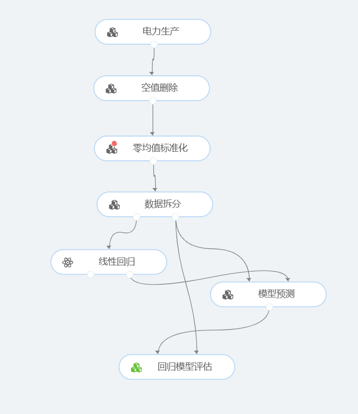

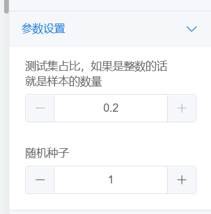

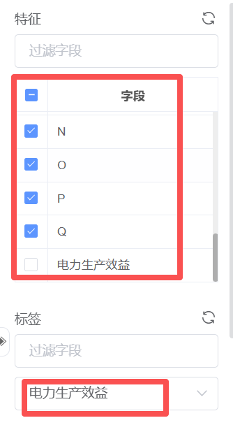

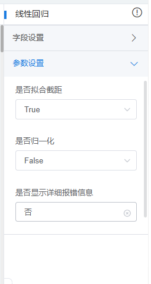

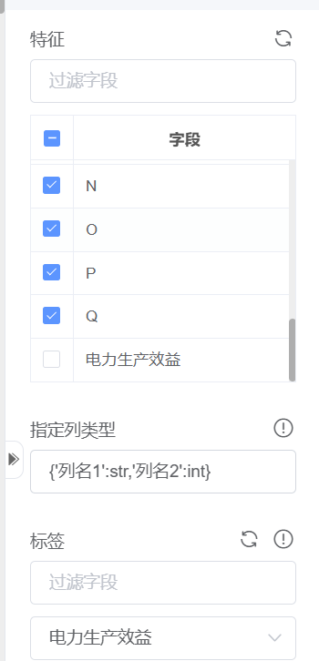

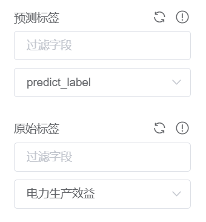

问题二

系数的绝对值越大影响越强。影响大的特征：O、E、H、K、N，其中O、H、K、N产生正向影响，E产生负向影响。

偏离正轨：D、E为负，此处我认为认为偏离正轨。产生的原因可能是：存在异常值，导致模型参数修正方向存在偏差；特征考虑不够全面，部分重要影响特征未放入模型进行训练。

问题三

数据清洗：统一格式、处理缺失值、去重与纠正。

特征编码：离散文本无法直接输入模型，需转换为数值形式。常用方法有标签编码、独热编码。例如：将“城市”等文本类别，转为多个新列（每列代表一个城市），样本所属城市对应列标1，其余标0。

---

## 第 7 题 · 二、项目流程实现（1.0分）

### 题目

二、项目流程实现

近年来，全球气候变暖态势持续加剧，极端气象事件频发，强降雨过程引发的城市内涝、山洪及地质灾害，对公共安全、基础设施运行与社会经济发展构成显著威胁。精准的降雨预测已成为气象预警、防汛调度与应急处置的核心技术支撑，而传统 Lasso 回归在处理多气象因子复杂关联关系、捕捉非线性影响特征时，预测精度与泛化能力存在明显局限。为进一步提升降雨预测准确性与可靠性，本研究在 Lasso 回归基础上引入 XGBoost 算法优化模型结构与训练流程，结合多模型性能对比及影响因子关联度深度分析，构建更高效的降雨预测方案，为防汛减灾决策提供科学、精准的技术支撑。依据以下步骤完成项目的实现，并保存提交项目链接。

问题一：对比评估指标分为误差损失类、拟合优度类、特殊分布 / 分位数损失类三类，简要说明三类指标用法。

问题二：建模中需通过皮尔逊、斯皮尔曼等相关系数量化特征与标签（降雨强度）的关联性（|r | 越大关联性越强：强关联 > 0.7、中等关联 0.3-0.7、弱关联≤0.3）；特征间 | r|>0.7 时存在强共线性，影响模型稳定性与可解释性。请基于关联度分析结果完成：

a. 选出与标签关联性最高的 4 个特征（按强弱排序）；

b. 判断是否存在特征间高度相似（强共线性）情况；

c. 简要说明常见强共线性处理方案。

问题三：根据题目要求完成下列流程：

步骤一：XGBoost。设置除降雨强度以外的字段作为特征，选择降雨强度作为标签，参数设置中设置最大迭代轮次350、树的深度5；

步骤二：XGBoost模型预测。设置除降雨强度以外的字段作为特征，选择降雨强度作为标签；

步骤三：回归模型对比评估。进行对比评估。

问题四：基于对比评估指标评估项目搭建的两个模型效果。

### 参考答案

问题一

误差损失类指标：数值越小，代表模型预测精度越高。

拟合优度类指标：数值越接近 1，代表模型拟合效果越好。

专用损失类指标：数值越小，模型表现越优。

问题二：

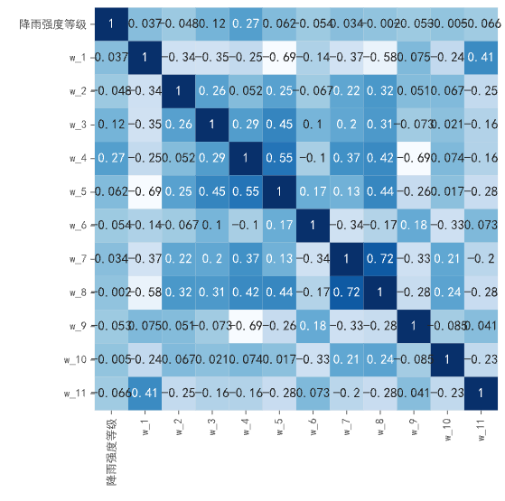

a. 相关系数的绝对值越大则代表其相关性越强，因此为w_4、w_3、w_11、w_5.

b. 存在，如w_7和w_8

c. 直接删除法：在高度相关的特征组（|r| > 0.7）中，保留一个（通常保留与标签相关性更强、或业务意义更明确的），删除其他。

主成分分析（PCA） / 线性降维：将存在共线性的多个原始特征，通过线性变换合并成少数几个互不相关的主成分（PC），用主成分作为新特征。

问题三

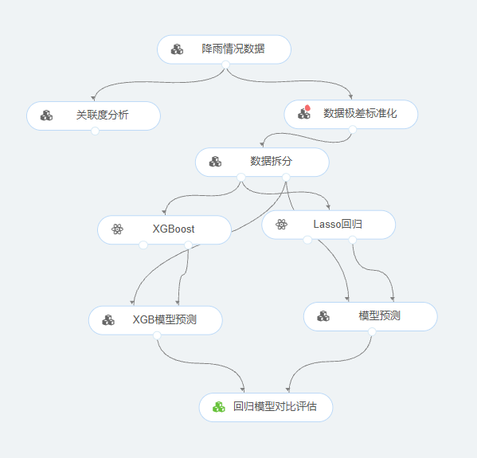

步骤一：

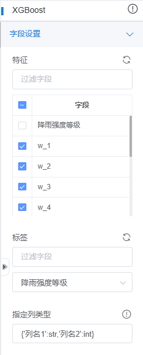

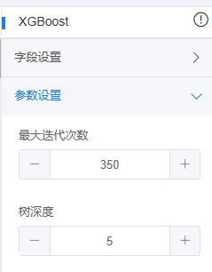

步骤二：

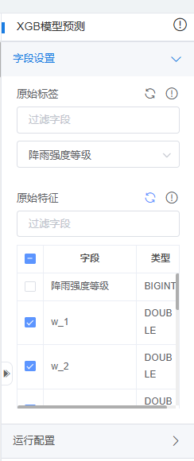

步骤三：

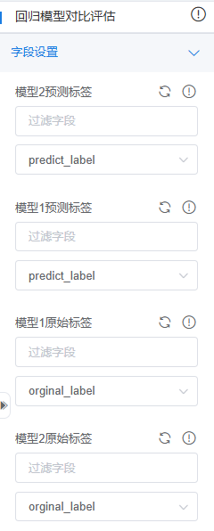

问题四

其中模型1为XGBoost模型，模型二为Lasso 回归模型

误差损失类指标核心判定规则为数值越小，模型预测精度越高。模型 1 的 MSE、RMSE、MAE、MAPE、MSLE均显著低于模型 2。

---

## 第 8 题 · 二、项目流程实现（1.0分）

### 题目

二、项目流程实现

随着电子商务市场竞争日趋激烈，基于用户行为数据的精细化运营已成为企业构筑核心优势的重要路径。以 L-PRFS模型（L:注册时长、P:最近一次购买时间间隔、R:购买频率、F:累计消费金额、S:平均折扣敏感度）为核心的用户价值分群体系，正成为驱动精准营销与用户生命周期管理的关键工具。

然而，在模型构建的实际过程中，原始交易数据往往存在记录缺失、退货干扰、异常下单行为等问题，且不同特征间的量纲差异显著，这直接影响了分群结果的准确性与可靠性。因此，必须建立一套严谨的数据处理与建模流程，涵盖从数据清洗、特征工程、标准化转换到聚类算法优化的完整链路。唯有如此，才能产出高质量的用户分层洞察，为后续的个性化产品推荐、差异化营销策略以及客户留存提升提供坚实的数据决策基础，最终实现平台整体用户价值的可持续增长。依据可视化开发环境完成以下任务，并提交最终的工程链接。

数据集包含以下字段：

用户标识与时间窗口

user_id：用户唯一标识，用于区分不同用户。

reg_date：用户注册时间，记录用户首次注册的具体日期。

obs_end_date：观测窗口结束时间点，表示数据采集或分析的时间截止点。

消费行为指标

order_count：消费频率，统计用户在观测期间内的下单次数。

amount_year_1：第一年消费金额，用户注册后第一年的累计消费金额。

amount_year_2：第二年消费金额，用户注册后第二年的累计消费金额。

total_spent：消费总金额，用户在观测期间内的总消费支出。

用户价值与行为特征

last_purchase_to_end：最近一次购买时间间隔，即用户最后一次购买日期到观测窗口结束日期的天数，用于衡量用户活跃度和流失风险。

avg_discount_rate：平均折扣率，用户在消费过程中使用的平均优惠折扣比例，反映用户对价格敏感度和促销依赖程度。

问题一：请简要说明一般项目的操作流程。

问题二：聚类分析通常通过轮廓系数值和簇内误差平方和综合来判别模型效果，请对其进行说明。

问题三：使用系统组件完成项目搭建。

步骤一：缺失值处理：选择全部字段，将缺失值所在的行删除。

步骤二：记录去重，将全部字段作为特征以及去重主键进行去重，分析去重结果。

步骤三：数据筛选，筛选第一年和第二年消费金额均大于0的数据作为正常数据。

步骤四：衍生变量，通过用户注册时间和观测窗口结束时间点计算注册时长L。

步骤五：数据筛选，筛选出L-PRFS模型所需特征。

步骤六：修改列名，将列名分别重命名为“R\F\P\S\L”。

步骤七：全表统计，对筛选出的数据进行统计并分析。

步骤八：数据标准化，将特征数据进行零均值标准化。

步骤九：KMeans，选择特征，聚类数设置为3。

问题四：请对项目搭建运行结果进行分析说明。

### 参考答案

问题一

数据读取→数据处理（缺失值、异常值处理）→特征工程（特征构建、筛选）→数据准备（数据向量化、标准化）→模型构建

问题二：

轮廓系数越接近1越好，簇内误差平方和越小越好。当其进行综合分析时，结合轮廓系数的全局峰值与 簇内误差平方和的肘部拐点特征综合进行对比分析，来判断其结果，特别是判断最优聚类数目时。

问题三

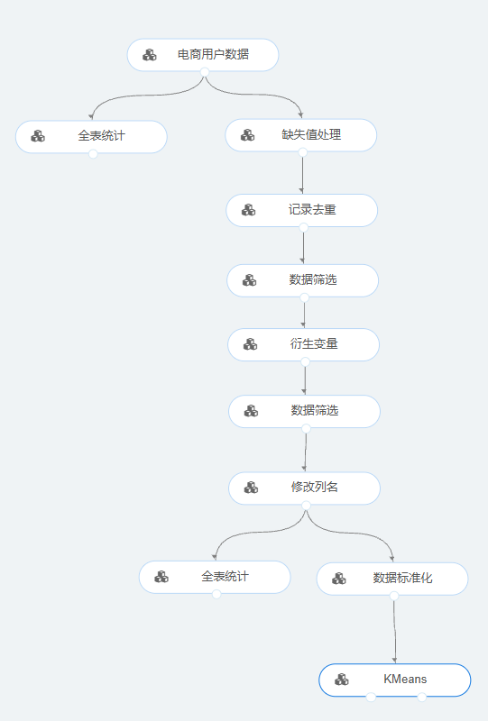

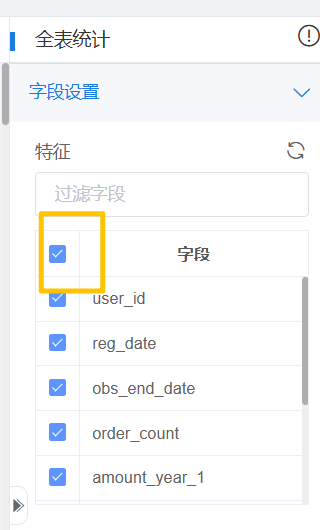

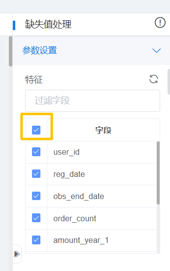

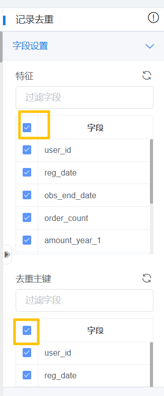

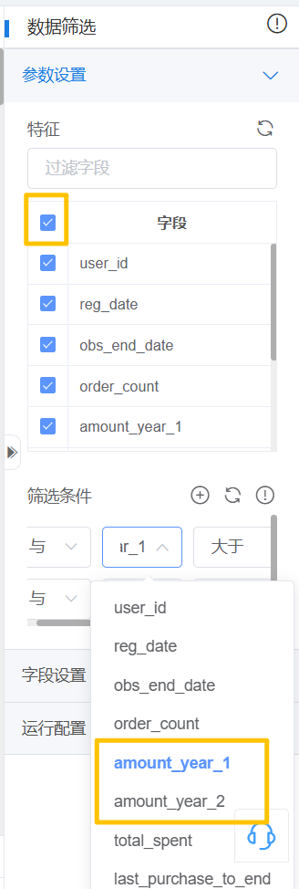

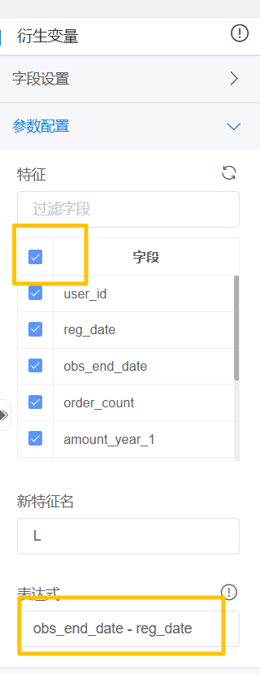

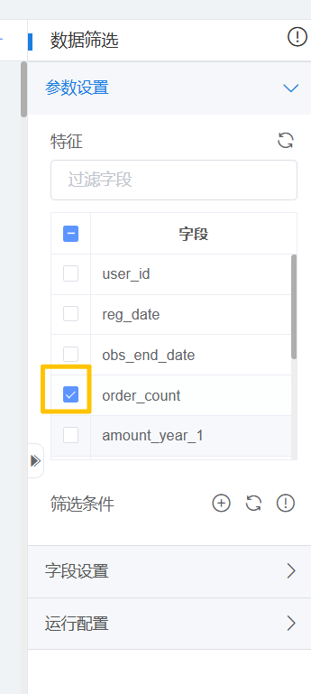

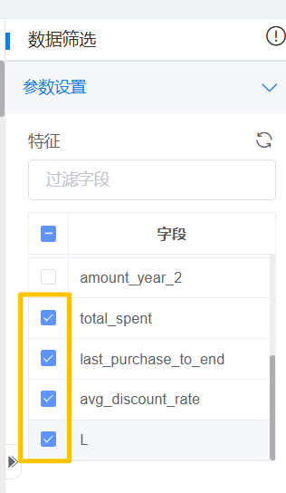

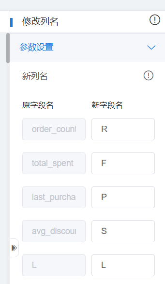

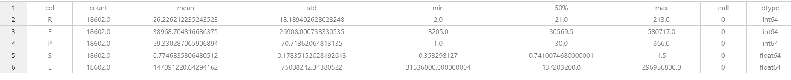

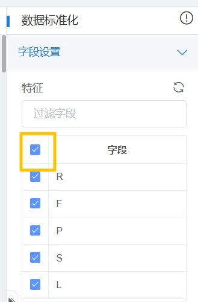

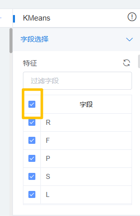

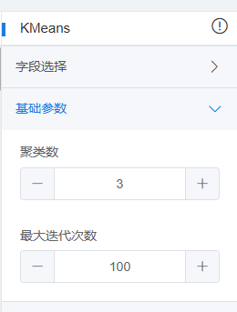

问题四

全表统计：数据统计显示，最大值这一列中最小值1.5、最大值超2亿，数值差异悬殊，需做数据标准化以消除量纲干扰。

数据标准化：总体而言，多数特征的极值差距悬殊，数据分布呈现出极强的离散性，需通过针对性的数据预处理手段对其进行优化，确保后续模型训练与分析工作的有效性。

K-Means:

群体3（基础大众用户）：占比64.4%（11,976人），是平台的用户基本盘。

群体1（促销驱动型活跃用户）：占比20.4%（3,801人），是短期贡献和活跃度的关键来源。

群体2（历史高价值用户）：占比15.2%（2,825人），是平台收入的历史支柱，但面临流失风险。

---

## 第 9 题 · 三、智能体系构建（1.0分）

### 题目

三、智能体系构建

伴随快速规模化发展，多数区域呈现出生活区与工作区显著分离的态势。由此产生的长距离、高频次潮汐式移动，已成为影响运行效率、消耗个体精力与增加系统负荷的核心挑战。解析“从何处来、往何处去”的空间关联，是优化布局结构、提升整体效能的重要前提。在此背景下，系统评估职住平衡状态，成为优化各市空间结构、推动可持续发展的关键切入点。

请依据数据及代码附件完成下题，运行出结果后提交完整代码文件。

步骤一：加载numpy库并加载LinearRegression库，并读取数据。

步骤二：绘制散点图进行分析。

步骤三：构建模型并使用X特征完成模型训练。

步骤四：模型预测。

步骤五：针对运行结果，进行结果分析形成完整书面表达。

### 参考答案

# 步骤一：加载numpy库并加载LinearRegression库，并读取数据。

import matplotlib.pyplot as plt

【1】import numpy as np

【2】from sklearn.linear_model import LinearRegression

【3】plt.rcParams['font.sans-serif'] = 'SimHei'

df_density = pd.read_csv('职住数量数据.csv', encoding='utf-8')

【4】df_traffic = pd.read_csv('/data/dataset/通勤压力数据.csv') # 数据为绝对路径

# 步骤二：绘制散点图进行分析。

【5】plt.scatter

【6】plt.title('职住数量与通勤压力之间的关系')

plt.xlabel('职住数量')

plt.ylabel('通勤压力')

# 步骤三：构建模型并使用X特征完成模型训练。

【7】LinearRegression()

regressor.fit(X, y)

【8】regressor.score(X, y) # 特征为X，标签为y

# 步骤四：模型预测。

【9】density_increase * coefficient

【10】regressor.predict([[density_new]]) # 预测数据需为二维数据

# 步骤五：针对运行结果，进行结果分析形成完整书面表达。

从散点图的分布结果可以直观地观察到，职住数量与通勤压力之间存在显著的正相关关系，即随着职住数量的上升，通勤压力也呈现相应增加的趋势。进一步通过构建线性回归模型进行量化分析，模型结果显示：职住数量对通勤压力的回归系数为0.01，而模型的决定系数高达0.99，说明职住数量能够解释通勤压力99%的变异，模型拟合优度非常高，两者之间的线性关系极为显著。根据模型参数具体测算，职住数量每增加200个单位，通勤压力相应上升约1.64个单位。在此基础上进行预测，当职住数量达到两千八时，模型给出的通勤压力预测值约为36。综合来看，职住数量是影响通勤压力的关键因素，该模型可为城市规划与交通管理提供定量参考依据。

---

## 第 10 题 · 三、智能体系构建（1.0分）

### 题目

三、智能体系构建
在娱乐消费体验向数字化、互动化升级的背景下，智能KTV系统已成为提升用户娱乐体验、优化服务运营的重要载体。从基础的歌曲点播到沉浸式互动娱乐，智能系统通过人机交互重构了消费者、娱乐内容与服务场景的关系，不仅要满足用户对便捷娱乐的需求，更需兼顾娱乐性、社交性与体验流畅度。当前，用户对KTV的需求已从“单一唱歌场所”转向“多功能社交娱乐空间”，如何设计流畅的娱乐交互流程、应对多样化的用户场景与实时需求，成为智能KTV系统落地的关键。在此背景下，构建清晰的用户与智能KTV系统互动框架，分析操作环节与潜在状况，并辩证看待系统优劣势，对推动娱乐产业智能化升级、提升用户满意度具有重要实践意义。
问题一：智能KTV系统提供多方式控制，请说明现实生活中点歌与灯光调节的具体步骤。
问题二：为优化智能KTV系统，请从现实角度出发，说明用户操作过程中系统的潜在问题并说明如何应对。

### 参考答案

问题一
智能KTV系统提供语音控制与移动终端控制双通道：
语音指令操控：用户说出预设唤醒词（如“小K点歌”）→ 系统激活语音监听 → 用户下达指令（如“点一首《稻香》”）→ 系统通过语义识别与曲库匹配触发点歌 → 执行后通过语音或界面反馈结果。
移动终端操控：用户打开KTV专用App或扫码进入点歌界面 → 与包厢主控系统完成连接 → 在终端界面选择功能（如点歌、调节音量、灯光模式）→ 确认后指令发送至主控系统执行 → App实时同步显示歌曲队列、播放状态及设备控制结果。
问题二
步骤一：系统启动与身份绑定
用户操作：通过包厢屏幕扫码登录或NFC识别启动系统。
潜在状况：网络延迟导致身份验证超时、多人同时绑定冲突、历史歌单同步失败。
系统应对：支持离线缓存登录、设置设备绑定优先级队列、提供手动歌单恢复选项。
步骤二：内容检索与点播
用户操作：语音搜索歌曲名/歌手，或在终端界面浏览分类榜单。
潜在状况：语音识别受包厢噪音干扰、方言导致识别错误、曲库版权限制无法播放。
系统应对：集成降噪算法与方言模型、提供近似歌曲推荐、明确提示版权限制并推荐替代曲目。
步骤三：演唱互动与实时调控
用户操作：演唱中通过语音/App调节音效（如混响强度）、切换灯光场景。
潜在状况：音频输出延迟、灯光与歌曲节奏不同步、多人控制指令冲突。
系统应对：优化本地音频处理算法、预设节奏同步的灯光模板、设置控制权动态分配机制。
步骤四：服务呼叫与反馈
用户操作：通过屏幕或App一键呼叫服务（加时、点餐、技术支持）。
潜在状况：服务请求遗漏、多包厢并发请求拥堵、配送实物延迟。
系统应对：设立请求分级响应机制（技术问题优先）、同步推送请求至服务员终端、提供预计等待时间提示。
步骤五：数据同步与体验优化
用户操作：离场后系统自动生成演唱报告并同步至用户账号。
潜在状况：用户拒绝数据收集、报告生成缓慢、个性化推荐过度固化。
系统应对：提供隐私设置开关、支持报告异步生成与离线推送、引入“探索模式”随机推荐新内容。

---

## 第 11 题 · 三、智能体系构建（1.0分）

### 题目

三、智能体系构建
为强化园区线上线下协同管理与服务体验，完善智慧园区整体建设方案，要求围绕规划总体描述、建设规划、园区基础设施建设、多端交互与导航功能实现、个性化推送与服务通知、数字化智能支付方案及对应结算流程、园区数据统计、运营优化、智能服务与反馈渠道、园区安全管控、绿色低碳运维展开编制，各模块需列明至少 2 项实施办法，形成完整可落地的建设内容。

### 参考答案

智慧园区建设规划
一、规划总体描述
本智慧园区建设规划深度融合人工智能、物联网、大数据、5G 通信与数字孪生技术，搭建 “感知 - 连接 - 计算 - 应用 - 优化” 一体化智慧管理体系，打通园区管理方、入驻企业、员工、访客等多方服务链路，实现管理数字化、服务智能化、运营高效化、安全可视化。通过线上线下场景联动，提升企业办公与人员办事便捷度，降低园区综合运营成本，打造集约、安全、高效、绿色的现代化智慧园区。
二、建设规划
分阶段推进硬件部署、系统集成、平台上线与迭代优化，首期完成基础网络与感知设备铺设，中期上线核心管理与服务平台，末期实现数据闭环与运营智能决策。
搭建园区统一数字中台，整合安防、物业、能耗、办公、商业服务等子系统，打破数据孤岛，实现一平台统管全园区业务。
建立标准规范与运维保障体系，明确建设、运营、安全管理权责，保障系统长期稳定运行。
三、园区基础设施建设
全域布设智能门禁、客流传感器、环境监测终端、智能电表 / 水表、高清 AI 摄像头等 IoT 设备，实时采集人员通行、区域密度、能耗、环境温湿度数据。
搭建 5G 专网 + WiFi 6 全覆盖网络，配置边缘计算节点，保障多设备并发接入与数据低时延传输。
部署园区数字孪生底座，完成园区建筑、设施、管线三维建模，实现物理园区与数字园区实时映射。
四、多端交互与导航功能实现
开发园区小程序、PC 管理端、大屏指挥端三类终端，支持企业、员工、访客、管理员分权限使用。
小程序内置室内外一体化导航，覆盖楼宇、楼层、会议室、停车场、商铺等点位，支持路径规划与位置共享。
采用蓝牙 AoA 定位与 NFC 识别技术，实现访客线上预约登记、线下扫码 / 刷脸核验通行，联动闸机与电梯调度。
五、个性化推送与服务通知
基于企业行业类型、员工岗位、使用频次，精准推送政策申报、物业通知、培训活动、招聘信息。
依据人员实时位置，推送周边空位（车位 / 会议室）、餐饮排队、便民服务点、应急疏散路线等提醒。
针对入驻企业定制专属服务推送，包括租金缴费提醒、消防巡检通知、政企对接活动邀约。
六、数字化智能支付方案及对应结算流程
支付方案：开通停车无感支付、园区餐饮 / 商超扫码支付、企业对公批量支付、刷脸消费支付。
结算流程：用户发起消费→系统自动扣费→实时生成交易凭证→分账至对应商户 / 园区账户→支持对账回溯。
配套服务：支持电子发票自动开具、费用明细一键导出、企业月度账单汇总与在线核销。
七、园区数据统计
建立数据采集清单，统合人员通行、能耗使用、设备运维、企业经营、消费行为、车位利用率等全维度数据。
搭建园区数据看板，按日 / 周 / 月生成统计报表，涵盖客流趋势、能耗总量、故障频次、企业入驻率等核心指标。
构建数据归档与脱敏机制，规范数据存储、调用与共享流程，保障数据合规可追溯。
八、运营优化
基于数据分析动态调整停车配额、保洁巡检路线、电梯运行策略，提升资源利用率与服务响应效率。
依据企业经营与入驻数据，优化园区招商方向与商铺业态配比，提升园区商业活力。
对能耗数据进行异常监测与趋势分析，制定节能调控方案，降低水电与公共设施能耗成本。
九、智能服务与反馈渠道
搭建 AI 智能客服 + 人工在线坐席双模式，提供报事报修、政策咨询、访客授权、投诉建议 7×12 小时响应。
开放小程序评价入口，支持对物业服务、设备运行、园区环境、消费体验进行评分与留言。
建立反馈闭环机制，自动分派工单至责任部门，限时处理并回访，形成 “提交 - 派单 - 处置 - 评价” 全流程管理。
十、园区安全管控
部署 AI 视频分析系统，实现区域入侵、烟火识别、人员聚集、高空抛物自动监测与告警。
搭建全网络安全防护体系，配置防火墙、入侵检测、数据加密机制，防范平台攻击与信息泄露。
联动应急广播与消防系统，发生异常时自动推送告警信息、引导疏散并通知管理方处置。
十一、绿色低碳运维
部署智能照明与空调控制系统，依据区域有人状态自动调节开关与功率，实现节能运行。
建立园区碳足迹统计模型，监测能耗、交通、办公等环节碳排放，生成低碳改造建议。
推行园区垃圾分类智能监测与积分激励，引导入驻企业与员工参与绿色运维。

---
